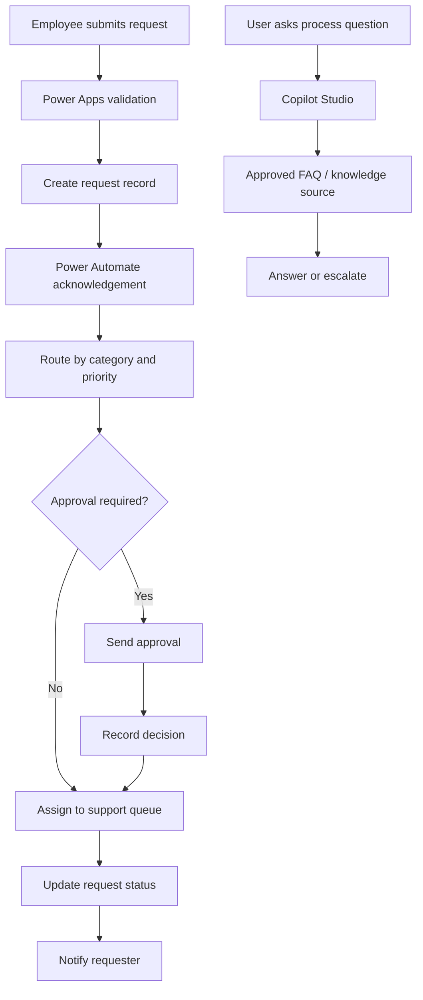

# Solution Architecture

## Goal

Design a manageable internal service-request process with a single intake path, transparent status tracking, automated routing, and an assistant that answers process questions from approved sources.

## Logical components

| Component | Responsibility | Notes |
|---|---|---|
| Power Apps canvas app | Submit and view requests | Use a responsive form and role-appropriate screens. |
| SharePoint list | Starter persistence layer | Appropriate for a simple prototype if permissions and data relationships remain manageable. |
| Dataverse | Alternative persistence layer | Prefer when the solution needs relational tables, richer security, or broader application lifecycle management. |
| Power Automate | Notifications, routing, approvals, and record updates | Add error handling, retries where appropriate, and operational monitoring. |
| Copilot Studio | FAQ and guided conversation | Ground answers in approved knowledge and provide a clear escalation path. |
| Microsoft 365 / Teams | User-facing notifications and access | Use only connectors and channels approved for the target tenant. |

## Request lifecycle

## Suggested status values

- Submitted
- Under review
- Awaiting approval
- Approved
- Rejected
- In progress
- Completed
- Cancelled

Agree on definitions and permitted transitions before implementation. A status field should not be freely editable by every requester.

## Design decisions

### SharePoint or Dataverse?

Start with SharePoint only if the proof of concept has simple relationships, modest data complexity, and a permissions model that can be enforced safely. Choose Dataverse when the solution needs stronger relational modeling, granular security roles, or a more formal application lifecycle. Validate licensing and environment constraints before deciding.

### Keep AI assistance bounded

The assistant should answer procedural questions from approved, maintained sources. It should not invent request statuses, make approval decisions, or expose records a user is not authorized to see. A user-specific request lookup should use authenticated identity and enforce data permissions outside the language model.

### Reliability and governance

- Define an owner for each flow and knowledge source.
- Handle connector failures and approval timeouts explicitly.
- Log useful operational metadata without unnecessarily copying sensitive request details.
- Use development/test environments before production.
- Use environment variables and connection references in a packaged solution where applicable.
- Confirm data loss prevention policies, connector licensing, retention, and audit requirements with the tenant administrator.

## Acceptance criteria for a future prototype

1. A valid request can be submitted and assigned a unique identifier.
2. Invalid required fields are caught before submission.
3. The requester receives an acknowledgement.
4. Routing follows documented category/priority rules.
5. Approval outcomes update the request and trigger a notification.
6. Unauthorized users cannot view or modify another person's request.
7. The assistant answers seeded FAQs from approved content and safely declines or escalates unsupported questions.
8. Failure cases are recorded and can be diagnosed by the owner.
